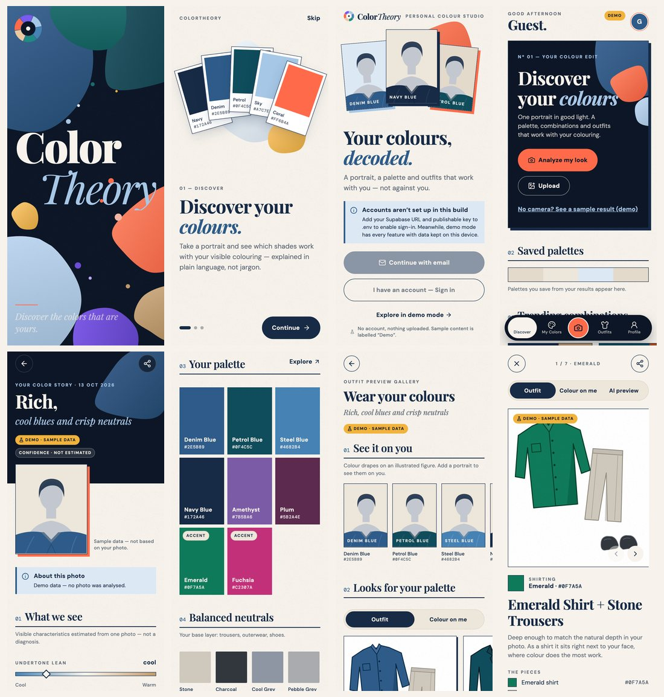

# ColorTheory

*Discover the colors that are yours.*

A personal colour-analysis and styling app for iOS and Android, built with Expo SDK 57,
Expo Router, Reanimated 4 and an optional Supabase backend. Take or upload a portrait, get a
colour story with an explained palette, see each colour draped against your own photo, explore
outfits built around your colours, and save what you love.



**Discover → Capture → Analyze → Explore Colors → Preview Outfits → Save Your Style**

### Principles baked into the code

- **Works with no backend and no API keys.** On-device analysis and demo mode cover every screen.
- **Private by default.** Portraits are analysed on the phone; uploading needs an explicit
  consent tap each time, and goes to a private bucket only the user's account can read.
- **Honest output.** Every result says where it came from (On-device estimate · Cloud analysis ·
  Demo · Colour drape · AI preview), shows confidence and photo-quality warnings, and can be
  adjusted. Demo content is never presented as real AI output; drapes never alter the face.
- **No secrets in the app.** Provider keys live in Supabase Edge Function secrets; the app
  refuses to start its client with a service-role key.

## Contents

- [Quick start](#quick-start-no-backend-needed)
- [Running on devices and simulators](#running-on-devices-and-simulators)
- [Configuration](#configuration)
- [Connecting Supabase](#connecting-supabase)
- [Enabling AI](#enabling-ai)
- [Scripts](#scripts)
- [Project structure](#project-structure)
- [Testing](#testing)
- [Builds](#development-and-production-builds)
- [Troubleshooting](#troubleshooting)
- Deeper docs: [Architecture](docs/ARCHITECTURE.md) · [Design system](docs/DESIGN_SYSTEM.md) ·
  [Supabase](docs/SUPABASE.md) · [AI providers](docs/AI_PROVIDERS.md) · [Testing](docs/TESTING.md)

## Quick start (no backend needed)

Prerequisites: Node.js `^20.19.4 || ^22.13.0 || ^24.3.0` (any OS), and either the **Expo Go**
app on a phone or an iOS Simulator / Android emulator.

```bash
npm install
npx expo start
```

Then press `i` (iOS Simulator), `a` (Android emulator), or scan the QR code with Expo Go
(Android) / the Camera app (iOS). On first launch you'll see the splash and onboarding; on the
welcome screen choose **Explore in demo mode**. Everything works on-device; no account needed.

No camera (simulators)? On Discover, tap **No camera? See a sample result (demo)**, or use
**Upload** to pick a photo from the library.

## Running on devices and simulators

| Option | Good for | Notes |
|---|---|---|
| **Expo Go** | Fastest start, real camera | Every native module this app uses ships in Expo Go (camera, image picker/manipulator, file system, secure store, haptics, SVG, Reanimated…). Auth email links use `exp://…` here — add `exp://**` to Supabase redirect URLs during development. |
| **Development build** | Your own app id, `colortheory://` deep links, production-like behaviour | `npx expo run:ios` / `npx expo run:android` (needs Xcode / Android Studio), or cloud: `npx eas-cli@latest build --profile development`. Then `npx expo start`. |
| **iOS Simulator** (macOS + Xcode) | UI work | No camera — use Upload or the demo sample. |
| **Android emulator** (Android Studio) | UI work | Emulated camera available. Reach a local Supabase at `10.0.2.2`, not `127.0.0.1`. |
| **Physical iPhone** | Camera, haptics, Face ID-protected Keychain | Expo Go, or a development build (Apple developer account for device install). |
| **Physical Android** | Camera, low-end performance checks | Expo Go, or install the development build APK. Phone and computer on the same network (or `npx expo start --tunnel`). |

Web (`npx expo start --web`) renders the UI for quick visual checks; camera/upload flows are
designed for mobile.

## Configuration

Copy `.env.example` to `.env.local` (git-ignored). Everything is optional.

| Variable | Default | Meaning |
|---|---|---|
| `EXPO_PUBLIC_SUPABASE_URL` | — | Project URL |
| `EXPO_PUBLIC_SUPABASE_PUBLISHABLE_KEY` | — | Publishable key (`sb_publishable_…`); or `EXPO_PUBLIC_SUPABASE_ANON_KEY` on legacy projects |
| `EXPO_PUBLIC_ANALYSIS_PROVIDER` | `device` | `device` · `remote` (Edge Function + Claude vision) · `mock` |
| `EXPO_PUBLIC_OUTFIT_GENERATION` | `mock` | `mock` · `remote` (Edge Function + FASHN) · `off` |
| `EXPO_PUBLIC_ENABLE_DEMO_MODE` | on without Supabase / in dev | Offer "Explore in demo mode" |
| `EXPO_PUBLIC_PRIVACY_URL`, `EXPO_PUBLIC_TERMS_URL` | — | Your published legal pages |

**Public vs secret.** `EXPO_PUBLIC_*` values are compiled into the app and readable by anyone
who downloads it — only values designed to be public go there (the Supabase URL and
publishable/anon key are; Row Level Security protects the data). Secrets — service-role or
`sb_secret_` keys, `ANTHROPIC_API_KEY`, `FASHN_API_KEY`, `CLEANUP_SECRET`, database passwords —
go only in `supabase/functions/.env` / `npx supabase secrets set`. `src/constants/config.ts`
validates the variables, reports problems in development (Settings → Developer diagnostics), and
refuses secret/service-role keys.

Restart with `npx expo start --clear` after changing env files.

## Connecting Supabase

Short version (details, RLS testing and the cleanup schedule in [docs/SUPABASE.md](docs/SUPABASE.md)):

```bash
npx supabase login
npx supabase link --project-ref <ref>
npx supabase db push                                   # schema, RLS, private buckets
```

1. Put the URL and publishable key in `.env.local`.
2. Authentication → URL configuration: Site URL `colortheory://`, redirect URLs
   `colortheory://**` (+ `exp://**` for Expo Go during development).
3. `npx expo start --clear` → Welcome now offers sign-up and sign-in.

## Enabling AI

```bash
cp supabase/functions/.env.example supabase/functions/.env   # add ANTHROPIC_API_KEY / FASHN_API_KEY
npx supabase secrets set --env-file supabase/functions/.env
npx supabase functions deploy analyze-portrait
npx supabase functions deploy generate-outfit
npx supabase functions deploy delete-account
npx supabase functions deploy cleanup-orphans --no-verify-jwt
```

Set `EXPO_PUBLIC_ANALYSIS_PROVIDER=remote` and/or `EXPO_PUBLIC_OUTFIT_GENERATION=remote`.
Cloud analysis uses Claude (`claude-opus-5-5`) with JSON-schema output; AI outfit previews use
FASHN virtual try-on. See [docs/AI_PROVIDERS.md](docs/AI_PROVIDERS.md) for the provider
comparison (pricing, free tiers, licensing, retention), quotas and the garment-photo workflow.

## Scripts

| Script | Does |
|---|---|
| `npm start` / `npm run start:clear` | Metro dev server (clear cache) |
| `npm run ios` / `npm run android` / `npm run web` | Start and open a platform |
| `npm run typecheck` | TypeScript (strict, typed routes) |
| `npm run lint` | ESLint |
| `npm test` | Jest unit/component tests (mocks only) |
| `npm run test:rls` | Schema + RLS scenarios on the real migrations (PGlite, no Docker) |
| `npm run test:integration` | Two-account RLS checks against a real test project (needs credentials) |
| `npm run verify` | typecheck + lint + test + test:rls |
| `npm run doctor` | `expo-doctor` |

## Project structure

```text
src/
├── app/                      Expo Router routes
│   ├── _layout.tsx           providers, fonts, session restore, protected route groups
│   ├── index.tsx             animated splash (anchor route)
│   ├── onboarding.tsx  auth-callback.tsx  reset-password.tsx  legal/[doc].tsx
│   ├── (auth)/               welcome, sign-in, sign-up, forgot-password, verify-email
│   └── (app)/                camera, portrait-confirmation, analysis, results/[id], palette/[id],
│       │                     gallery/[id], outfit/[outfitId], history, settings, portraits
│       └── (tabs)/           discover, colors, outfits, profile
├── components/               ui/, layout/, brand/, colors/, outfits/, camera/, analysis/
├── features/                 auth, camera, analysis (engines + workflow), outfits, colors, data, profile, splash
├── services/                 color-analysis, image-generation, data (repositories), storage, supabase
├── store/                    preferences (persisted), session flags (memory)
├── theme/                    colors, typography, spacing, radii, shadows, motion, fonts
├── types/  utils/  constants/  mocks/  lib/
supabase/                     migrations, Edge Functions, RLS tests, config.toml
docs/                         architecture, design system, Supabase, AI providers, testing
```

## Testing

`npm run verify` runs 150 Jest tests (colour science against published CIEDE2000 values,
palette/outfit engines, synthetic-image quality checks, auth flows, the analysis orchestrator's
consent and cleanup rules, provider/Edge Function contracts, repositories, secure storage and
shared UI states) plus 55 database scenarios that load the real migrations and act as two users,
`anon` and the service role. Credentialed integration tests and manual device scenarios are in
[docs/TESTING.md](docs/TESTING.md).

## Development and production builds

`eas.json` defines `development`, `development-simulator`, `preview` and `production` profiles.

```bash
npx eas-cli@latest login
npx eas-cli@latest build --profile development --platform ios        # or android
npx eas-cli@latest build --profile production --platform all
npx eas-cli@latest submit --platform ios                              # store submission
```

Local native builds: `npx expo run:ios` / `npx expo run:android` (generates `ios/`/`android/`,
which are git-ignored — configure native settings in `app.json`). Set production env values as
EAS environment variables (`npx eas-cli@latest env:create`), not in committed files.

## Troubleshooting

| Problem | Try |
|---|---|
| Metro errors / stale bundle | `npx expo start --clear`; delete `.expo/`; reinstall `node_modules` |
| Dependency version mismatch | `npx expo install --check` then `npx expo install --fix`; `npx expo-doctor` |
| "Unmatched route" / typed route errors | Routes live in `src/app`; restart Metro to regenerate `.expo/types`; check the file name matches the `href` |
| Missing / wrong env vars | Settings → Developer diagnostics (dev builds) lists config issues; restart with `--clear` after edits; variables must start with `EXPO_PUBLIC_` |
| Camera shows "unavailable" | Simulators have no camera — use Upload or the demo sample; on devices check another app isn't holding the camera |
| Camera permission denied | Settings → ColorTheory → Camera; the app links there. On iOS the prompt only appears once |
| Sign-up email link opens a browser error | Add `colortheory://**` (dev build) or `exp://**` (Expo Go) to Supabase redirect URLs; open the link on the same phone |
| "That link was opened on a different device" | PKCE links only work on the device that requested them; sign in with the password instead |
| Signed out unexpectedly | Refresh token revoked/expired — the welcome screen says so; sign in again |
| Storage "row-level security" error on upload | The analysis row must exist and the path must be `{uid}/{analysisId}/original.jpg`; check `db push` applied the storage migration |
| Upload fails / stalls | Check connectivity (offline banner), file size ≤ 10 MB, bucket exists; retry from the analysis screen |
| "Cloud analysis isn't configured" | Deploy `analyze-portrait` and set `ANTHROPIC_API_KEY`; or switch back to `EXPO_PUBLIC_ANALYSIS_PROVIDER=device` |
| AI preview errors | `FASHN_API_KEY` set? Credits left (`OutOfCredits`)? Daily limit (`AI_PREVIEW_DAILY_LIMIT`)? Portrait stored in the cloud? Function logs: dashboard → Edge Functions |
| Edge Function 401 at the gateway | Projects on asymmetric JWT keys: set `verify_jwt = false` for user-facing functions (they verify tokens in code) |
| Android emulator can't reach local Supabase | Use `http://10.0.2.2:54321` (emulator) or your LAN IP (device) |
| iOS: build/sign errors | Xcode + Command Line Tools installed; open the simulator once; for devices an Apple developer team is required (`eas build` handles signing) |
| Fonts look like system fonts | Font loading timed out (4 s) or failed — the app falls back deliberately; check network on first web load |

## Notes

- The **"Shades of Blue Style Guide" reference image** wasn't included with the brief. The
  results screen follows its written description: navy masthead with serif title, a row of
  portrait panels in different blues with labels, labelled swatches with hex codes, outfit
  suggestions and a closing style statement.
- On-device analysis is a heuristic estimate from one photo, not a diagnosis; the app says so
  wherever results appear.
- `LICENSE` is the MIT license inherited from the Expo template — replace it with your own.
